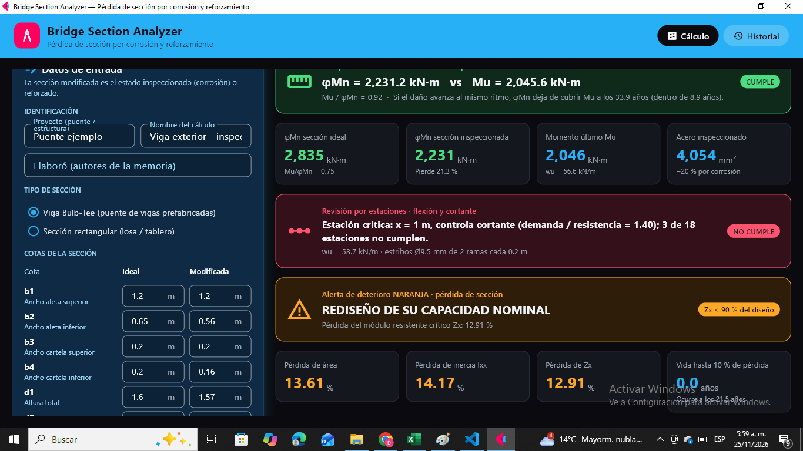
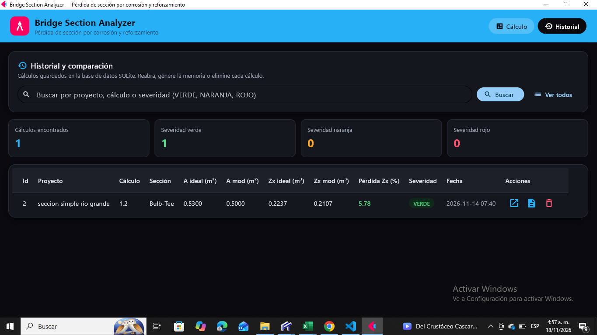
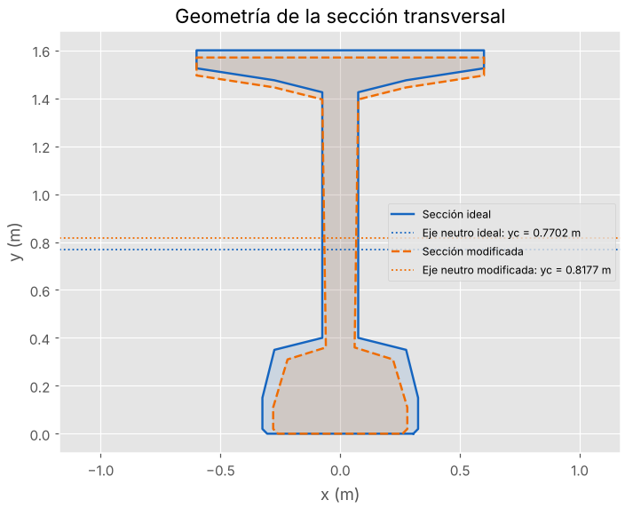
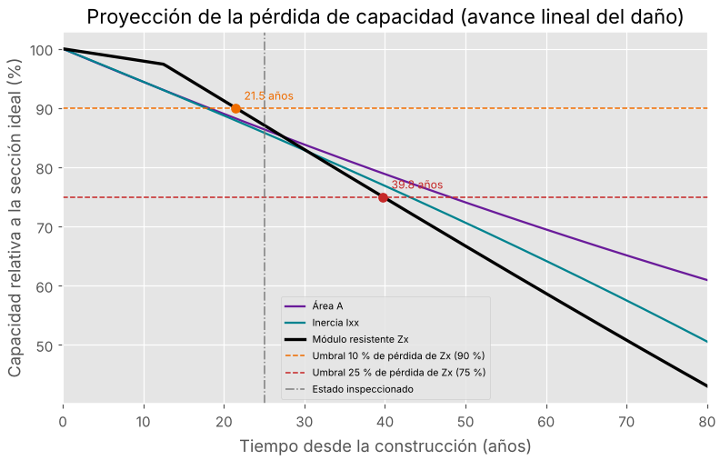

# Bridge Section Analyzer: pérdida de sección por corrosión y reforzamiento

**Proyecto 02, Programación II (2026-III, Grupo 18)**
Universidad Distrital Francisco José de Caldas · Facultad Tecnológica · Ingeniería Civil

Aplicación de escritorio (Flet) para evaluar cómo cambia la capacidad geométrica de una
sección transversal de puente cuando pierde material por **corrosión, desgaste o daño**, o
cuando gana material por **reforzamiento**. Compara la sección ideal de diseño con la
sección inspeccionada, clasifica la severidad y proyecta en qué momento se cruzarían los
umbrales de intervención si el daño sigue avanzando. Además, guarda los cálculos en SQLite
y genera la memoria de cálculo en Word.

| Vista Cálculo | Vista Historial |
|---|---|
|  |  |

Gráficas que produce la aplicación para el caso de ejemplo:

| Geometría | Proyección de la capacidad |
|---|---|
|  |  |

Ejemplo de memoria generada: [`ejemplos/memoria_ejemplo.docx`](ejemplos/memoria_ejemplo.docx)

---

## 1. Problema de ingeniería

En los puentes de vigas prefabricadas, la corrosión del concreto y del acero por
escorrentía, cloruros o filtraciones en juntas reduce las dimensiones efectivas de la
sección. La pérdida suele concentrarse en la aleta inferior y en el alma. En el primer
momento, la pérdida de **área** es la más visible, pero lo que controla la capacidad a
flexión es el **módulo resistente** `Zx = Ixx / c`. Una pérdida de área pequeña puede
causar una pérdida de Zx mayor si el material perdido está lejos del eje neutro.
El programa responde tres preguntas:

1. ¿Cuánto cambian A, el centroide, Ixx, Iyy y Zx respecto a la sección de diseño?
2. ¿Qué tan grave es el daño? Se clasifica por la pérdida de Zx:
   | Pérdida de Zx | Clasificación | Dictamen |
   |---|---|---|
   | < 10 % | VERDE | Mantenimiento preventivo |
   | 10 % a 25 % | NARANJA | Rediseño de su capacidad nominal |
   | > 25 % | ROJO | Intervención inminente |
3. Si el daño sigue avanzando al mismo ritmo, ¿**cuándo** se alcanzan los umbrales del
   10 % y del 25 %, y cuánta vida remanente queda?

Secciones disponibles: **viga Bulb-Tee** (14 cotas) y **sección rectangular** (losa o tablero).

## 2. Fundamento teórico y métodos numéricos

### 2.1 Propiedades del polígono (NumPy, vectorizado)

La librería `pysections` genera la sección como un polígono de vértices `(xᵢ, yᵢ)`. Con
`cᵢ = xᵢ·yᵢ₊₁ − xᵢ₊₁·yᵢ`, el teorema de Green da:

```
A   = ½ Σ cᵢ                 Qx = ⅙ Σ cᵢ (yᵢ + yᵢ₊₁)        Qy = ⅙ Σ cᵢ (xᵢ + xᵢ₊₁)
xc  = Qy / A                 yc = Qx / A
Ixx = (1/12) Σ cᵢ (yᵢ² + yᵢyᵢ₊₁ + yᵢ₊₁²) − A·yc²
Iyy = (1/12) Σ cᵢ (xᵢ² + xᵢxᵢ₊₁ + xᵢ₊₁²) − A·xc²
Zx,inf = Ixx / yc      Zx,sup = Ixx / (h − yc)      Zx = mín(Zx,inf, Zx,sup)
Variación (%) = (Modificada − Ideal) / Ideal × 100
```

En `app/modelo.py::propiedades_lote` las sumas se hacen con `np.roll` y operaciones sobre
arreglos de forma `(n, m, 2)`, sin ciclos `for`. Así, una sola llamada evalúa **n
secciones a la vez**, y eso es lo que permite construir la malla de la sección 2.2.

### 2.2 Proyección de la degradación (SciPy: `optimize.brentq`)

Se supone que el daño avanzó de forma lineal desde la construcción (α = 0, sección ideal)
hasta la inspección (α = 1, sección modificada) y que sigue al mismo ritmo. Las coordenadas
de los vértices son funciones lineales de las cotas, así que la sección con nivel de daño
α es:

```
P(α) = P_ideal + α · (P_modificada − P_ideal)        t(α) = α · t_inspección
```

1. Se evalúa una **malla** de 200 valores de α con NumPy, todos a la vez.
2. Se buscan los intervalos donde `f(α) = 100·Zx(α)/Zx,ideal − (100 − umbral)` cambia de signo.
3. En cada intervalo, `scipy.optimize.brentq` calcula la raíz α* con tolerancia de 1e-10.

Se eligió el método de Brent porque `Zx(α)` es continua pero **no derivable** en el punto
donde la fibra crítica pasa de la superior a la inferior (es el quiebre que se ve en la
gráfica). Brent garantiza convergencia con un intervalo que encierra la raíz y no necesita
derivadas, mientras que Newton podría fallar en ese quiebre. Si la sección fue reforzada,
Zx no baja y el programa informa que el umbral no se alcanza.

### 2.3 Validación

`tests/test_modelo.py` compara el modelo con casos resueltos a mano:

| Caso | Valor a mano | Programa |
|---|---|---|
| Rectángulo 2.00 × 0.25 m | A = 0.5 m², Ixx = b h³/12 = 2.6042e-3 m⁴, Zx = b h²/6 = 2.0833e-2 m³ | igual (1e-12) |
| Triángulo b = 3, h = 2 | A = 3, Ixx = b h³/36 = 0.6667, Iyy = 1.5, Ixy = −0.5 | igual |
| Ancho 2.00 → 1.80 m | pérdida de A, Ixx y Zx = 10 % → NARANJA | igual |
| brentq en el rectángulo (Zx ∝ b) | 10 % en α = 1 (20 años) y 25 % en α = 2.5 (50 años) | igual (1e-8) |
| Bulb-Tee de ejemplo | resultados de `pysections` (A, z, Iyy, Izz, wi, ws) | igual |

**Unidades:** longitudes en m, áreas en m², módulos resistentes en m³, inercias en m⁴ y tiempo en años.

## 3. Instalación y ejecución

Requisitos: **Python 3.11 o superior** y Git.

```bash
git clone https://github.com/Stroykhow/CALCULO-Y-ANALISIS-DE-SECCIONES-GEOMETRICAS-PARA-PERDIDAS-POR-CORROSION-Y-REFORZAMIENTO.git
cd CALCULO-Y-ANALISIS-DE-SECCIONES-GEOMETRICAS-PARA-PERDIDAS-POR-CORROSION-Y-REFORZAMIENTO

python -m venv .venv
# Windows
.venv\Scripts\activate
# Linux / macOS
source .venv/bin/activate

pip install -r requirements.txt
python main.py          # o: flet run
```

La base de datos `datos/proyectos.db` se crea sola la primera vez que se ejecuta el
programa. Las memorias se guardan en `reportes/`. Git ignora ambas carpetas.

Pruebas:

```bash
pytest
```

Para regenerar la memoria de ejemplo: `python herramientas/generar_ejemplo.py "Autor 1 y Autor 2"`.

## 4. Uso paso a paso

1. **Cálculo**: escriba el proyecto, el nombre del cálculo y los autores.
2. Elija el tipo de sección. Para ver un caso completo, pulse **Cargar ejemplo**.
3. Escriba las cotas de la **sección ideal** y de la **sección modificada**, en metros. Si
   conoce la **edad** de la estructura en la inspección, escríbala para obtener la
   proyección en años.
4. Pulse **Calcular**. Verá la clasificación, la tabla comparativa y dos gráficas: la
   geometría y la proyección de la capacidad. Los campos vacíos, con letras o con valores
   negativos se marcan en rojo, y las geometrías imposibles se informan con un mensaje,
   sin que la aplicación se cierre.
5. Pulse **Guardar en historial** para guardar el cálculo en SQLite.
6. Pulse **Generar memoria .docx** para crear el informe en Word y abrirlo.
7. **Historial**: busque por proyecto, cálculo o severidad y compare los cálculos en la
   tabla. Cada fila permite **reabrir** el cálculo, generar su **memoria** o **eliminarlo**
   (con confirmación).

## 5. Estructura del proyecto

```text
├── main.py                  # punto de entrada: arranca la app Flet
├── requirements.txt         # versiones fijadas
├── pytest.ini
├── app/
│   ├── sections.py          # pysections (Proyecto 01), sin modificar: genera la geometría
│   ├── modelo.py            # cálculo vectorizado (NumPy) + proyección (SciPy brentq), sin Flet
│   ├── validacion.py        # lectura y validación de campos numéricos
│   ├── db.py                # SQLite: proyectos 1─N calculos, consultas parametrizadas
│   ├── graficas.py          # figuras de Matplotlib (las mismas en la app y en la memoria)
│   ├── reporte.py           # memoria de cálculo con docxtpl
│   └── ui/
│       ├── app.py           # ventana y navegación
│       ├── vista_calculo.py # formulario, resultados y gráficas
│       ├── vista_historial.py # listar, buscar, reabrir, memoria, eliminar
│       ├── estilos.py       # paleta y componentes visuales (tarjetas, indicadores)
│       ├── utilidades.py
│       └── compat.py        # diferencias entre versiones de Flet
├── plantillas/memoria.docx  # plantilla Jinja propia (, InlineImage)
├── herramientas/
│   ├── crear_plantilla.py   # regenera la plantilla
│   └── generar_ejemplo.py   # regenera ejemplos/memoria_ejemplo.docx
├── tests/                   # pytest: modelo, base de datos y reporte
└── ejemplos/
    ├── memoria_ejemplo.docx
    └── capturas/
```

### Base de datos

```text
proyectos(id PK, nombre UNIQUE, descripcion, creado)
calculos(id PK, proyecto_id FK → proyectos.id ON DELETE CASCADE, nombre, tipo_seccion,
         param_ideal JSON, param_mod JSON, edad_anios, area_ideal, area_mod,
         zx_ideal, zx_mod, perdida_zx, severidad, dictamen, creado)
```

## 6. Reutilización del Proyecto 01

* `sections.py` (pysections) se usa **sin modificar**; solo se movió a `app/`. Sigue siendo
  el núcleo que genera los vértices de cada sección, y una prueba verifica que el modelo
  nuevo reproduce sus resultados.
* `section_comparison.py` y el `main.py` de consola del Proyecto 01 se reemplazaron por
  `app/modelo.py`. Este módulo conserva la misma fórmula de variación y los mismos
  criterios de severidad, pero calcula de forma vectorizada (`pysections` usa ciclos
  `for`), incluye la proyección con SciPy y no tiene dependencias de la interfaz.

## 7. Referencias

* Gere, J. M., & Goodno, B. J. (2013). *Mecánica de materiales* (8.ª ed.). Cengage Learning.
* Steger, C. (1996). *On the calculation of arbitrary moments of polygons*. Technical Report FGBV-96-05, TU München.
* AASHTO (2020). *LRFD Bridge Design Specifications* (9.ª ed.).
* AIS (2010). *Reglamento Colombiano de Construcción Sismo Resistente NSR-10*, Título C.
* Brent, R. P. (1973). *Algorithms for Minimization without Derivatives*. Prentice-Hall.
* Ramírez Vargas, C. D. (2025). *sections.py*, librería de propiedades de secciones (GPL-3.0).

## 8. Autores

| Nombre | Código | Usuario GitHub |
|---|---|---|
| _Estudiante 1_ | _código_ | `Stroykhow` |
| _Estudiante 2_ | _código_ | _usuario_ |
